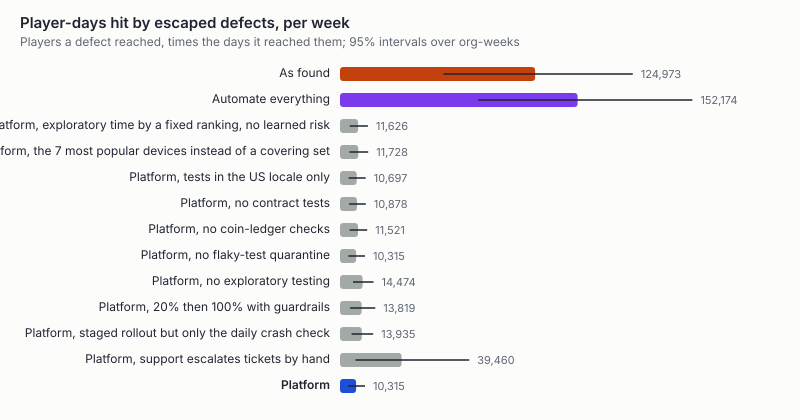

# reward-app-quality-platform

<!-- results:start -->

### Dashboard (development orgs)

| Development | Platform | Automate everything | As found |
|---|---:|---:|---:|
| Defects found before release | **62 of 83** | 28 of 83 | 32 of 83 |
| Defects in coins or cash-outs that reached players | **5** | 33 | 32 |
| Player-days hit by escaped defects, per week (95% interval) | **10,315 (5,292–16,017)** | 152,174 (88,546–225,725) | 124,973 (66,225–187,590) |
| ... of them in money flows | **771** | 80,945 | 92,613 |
| Median hours to find an escaped defect | **19.0** | 38.5 | 30.0 |
| Escaped defects nobody found within two weeks | **4** | 10 | 10 |
| QA hours per week | **18.0** | 11.7 | 32.3 |
| Flaky test failures per week | **0.9** | 20.8 | 0.0 |
| Device farm per week | **€145** | €194 | €0 |
| Median hours from code freeze to every player | **43.7** | 25.5 | 39.0 |
| Rollouts halted by a guardrail (false halts) | **6 (1)** | 0 (0) | 0 (0) |
| Cost of quality per week | **€2,969** | €47,508 | €50,175 |

3 simulated orgs, 12 weeks each, 500,000 daily players: 72 releases, 517 module changes, 83 defects.

### Every design on the same orgs

| Design | Found before release | Money defects escaped | Player-days / wk | QA h / wk | Lead h | Cost / wk |
|---|---:|---:|---:|---:|---:|---:|
| As found | 32 of 83 | 32 | 124,973 | 32.3 | 39.0 | €50,175 |
| Automate everything | 28 of 83 | 33 | 152,174 | 11.7 | 25.5 | €47,508 |
| Platform, exploratory time by a fixed ranking, no learned risk | 61 of 83 | 5 | 11,626 | 18.0 | 43.7 | €3,135 |
| Platform, the 7 most popular devices instead of a covering set | 57 of 83 | 6 | 11,728 | 18.1 | 43.7 | €3,158 |
| Platform, tests in the US locale only | 57 of 83 | 7 | 10,697 | 18.1 | 43.7 | €3,137 |
| Platform, no contract tests | 48 of 83 | 19 | 10,878 | 18.4 | 43.5 | €3,283 |
| Platform, no coin-ledger checks | 55 of 83 | 12 | 11,521 | 18.2 | 43.7 | €3,543 |
| Platform, no flaky-test quarantine | 62 of 83 | 5 | 10,315 | 18.9 | 43.7 | €3,018 |
| Platform, no exploratory testing | 55 of 83 | 7 | 14,474 | 6.2 | 37.7 | €2,822 |
| Platform, 20% then 100% with guardrails | 62 of 83 | 5 | 13,819 | 18.0 | 31.7 | €3,520 |
| Platform, staged rollout but only the daily crash check | 61 of 83 | 6 | 13,935 | 17.9 | 43.7 | €3,925 |
| Platform, support escalates tickets by hand | 62 of 83 | 5 | 39,460 | 18.3 | 43.7 | €5,448 |
| **Platform** | 62 of 83 | 5 | 10,315 | 18.0 | 43.7 | €2,969 |

<!-- results:end -->
