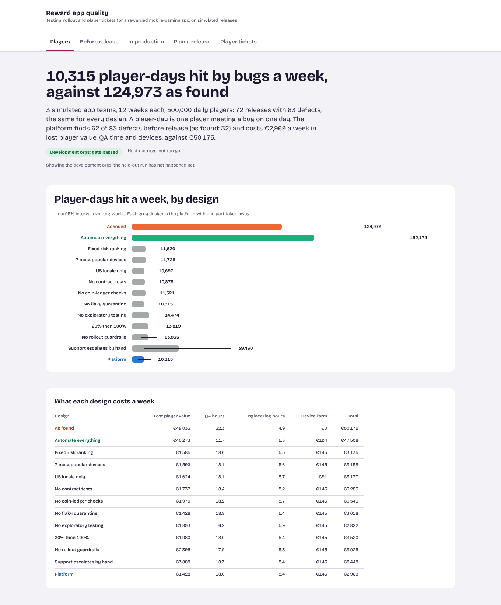
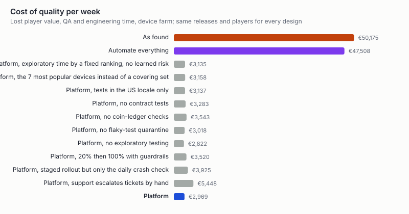

# reward-app-quality-platform

Quality platform for a rewarded mobile-gaming app, where players earn coins and cash them out through PayPal or
gift cards. A bug there costs more than a bad review: a stuck cash-out loses a player's trust, and coins credited
twice are paid out for real. The platform's job is to keep the number of players who meet a bug small while
releases ship twice a week, and to spend the QA chapter's time where it counts. It covers:

- **Risk-based testing before release.** End-to-end tests (Maestro, Espresso) run on a device matrix that covers
  every maker, Android version and low-end tier many players use. Exploratory hours go to the flows a model of the
  team's own history ranks riskiest. Contract tests (Pact) sit between the app and the backend, and a check verifies
  every coin balance against its ledger.
- **Staged rollout with guardrails.** Releases go to 1%, 10%, 50% and then everyone. Crashes, failed cash-outs and
  odd coin balances are checked per device class against each segment's baseline, and the rollout halts on a real
  excess.
- **A ticket agent.** It reads what players write in English, German and French and labels each ticket with a flow
  and a symptom. Code files a bug when a count jumps.
- **A real app and backend, tested for real.** A Kotlin rewards backend (Ktor) with idempotent cash-outs and a coin
  ledger, and an Android app that calls it. Pact contracts sit between them, with Espresso and Maestro flows on an
  emulator in CI, including the double-tapped cash-out.

Everything is measured on simulated app teams, against the app as found (a manual checklist on the four most
popular phones) and against automating every test on every device, with the same releases, defects and players for
every design.



## Results

<!-- results:start -->

### Dashboard (development orgs)

| Development | Platform | Automate everything | As found |
|---|---:|---:|---:|
| Defects found before release | **62 of 83** | 28 of 83 | 32 of 83 |
| Defects in coins or cash-outs that reached players | **5** | 33 | 32 |
| Player-days hit by escaped defects, per week (95% interval) | **10,315 (5,292–16,017)** | 152,174 (88,546–225,725) | 124,973 (66,225–187,590) |
| ... of them in money flows | **771** | 80,945 | 92,613 |
| Median hours to find an escaped defect | **19.0** | 38.5 | 30.0 |
| Escaped defects nobody found within two weeks | **4** | 10 | 10 |
| QA hours per week | **18.0** | 11.7 | 32.3 |
| Flaky test failures per week | **0.9** | 20.8 | 0.0 |
| Device farm per week | **€145** | €194 | €0 |
| Median hours from code freeze to every player | **43.7** | 25.5 | 39.0 |
| Rollouts halted by a guardrail (false halts) | **6 (1)** | 0 (0) | 0 (0) |
| Cost of quality per week | **€2,969** | €47,508 | €50,175 |

3 simulated orgs, 12 weeks each, 500,000 daily players: 72 releases, 517 module changes, 83 defects.




### Every design on the same orgs

| Design | Found before release | Money defects escaped | Player-days / wk | QA h / wk | Lead h | Cost / wk |
|---|---:|---:|---:|---:|---:|---:|
| As found | 32 of 83 | 32 | 124,973 | 32.3 | 39.0 | €50,175 |
| Automate everything | 28 of 83 | 33 | 152,174 | 11.7 | 25.5 | €47,508 |
| Platform, exploratory time by a fixed ranking, no learned risk | 61 of 83 | 5 | 11,626 | 18.0 | 43.7 | €3,135 |
| Platform, the 7 most popular devices instead of a covering set | 57 of 83 | 6 | 11,728 | 18.1 | 43.7 | €3,158 |
| Platform, tests in the US locale only | 57 of 83 | 7 | 10,697 | 18.1 | 43.7 | €3,137 |
| Platform, no contract tests | 48 of 83 | 19 | 10,878 | 18.4 | 43.5 | €3,283 |
| Platform, no coin-ledger checks | 55 of 83 | 12 | 11,521 | 18.2 | 43.7 | €3,543 |
| Platform, no flaky-test quarantine | 62 of 83 | 5 | 10,315 | 18.9 | 43.7 | €3,018 |
| Platform, no exploratory testing | 55 of 83 | 7 | 14,474 | 6.2 | 37.7 | €2,822 |
| Platform, 20% then 100% with guardrails | 62 of 83 | 5 | 13,819 | 18.0 | 31.7 | €3,520 |
| Platform, staged rollout but only the daily crash check | 61 of 83 | 6 | 13,935 | 17.9 | 43.7 | €3,925 |
| Platform, support escalates tickets by hand | 62 of 83 | 5 | 39,460 | 18.3 | 43.7 | €5,448 |
| **Platform** | 62 of 83 | 5 | 10,315 | 18.0 | 43.7 | €2,969 |

<!-- results:end -->

## What is real and what is simulated

| Part | Real | Simulated |
|---|---|---|
| Rewards backend (`mobile/backend`) | Kotlin, Ktor: sign-in, coins per round, cash-outs keyed by idempotency key, a coin ledger with a balance check. Tests: a retried cash-out pays once, twenty concurrent taps pay once, no cash-out without coins or a key. | – |
| Contracts (`mobile/api-client`, Pact) | The app's API client writes six interactions as a Pact contract (sign-in, a round, a cash-out, the same cash-out replayed, a refused cash-out, the balance); the backend's build verifies the running service against them. | – |
| Android app (`mobile/app`) | Kotlin app that signs in, plays rounds and cashes out, button disabled while a request is in flight, the same key on a retry. Espresso tests and three Maestro flows run on an Android emulator against the backend in CI. | – |
| Testing, rollout and triage (`raq/testing`, `raq/rollout`, `raq/triage`) | The risk model, device selection, exploratory planning, flaky-test detector, guardrail test, ticket reader and cluster test; a release planner and ticket reader in the dashboard. | The 72 releases, 83 defects and the tickets they are measured on. |

## Limits

- Every number in the results is about simulated app teams. How often changes carry defects, and how good each
  kind of test is at finding each kind of defect, are assumptions in `config/world.yaml`. The ablations show which
  part of the platform carries each result.
- Few defects per org-week make the intervals wide: as found ranges from about 66,000 to 188,000 player-days a week (95% interval).
- The ticket reader's lexicon was written against the simulated tickets' phrasing. Real tickets will read worse;
  the Claude reader (`RAQ_READER=claude`) is the production path, to be measured on a labelled sample first.
- Player value per player-day is priced from public revenue and player numbers, not from JustPlay's data.
- The app is a minimal screen, not a game; there is no iOS app, so XCTest is not exercised.

## Run it

```bash
pip install -r requirements-dev.txt
python -m pytest                       # seconds
python -m raq.eval.cli evaluate        # development orgs: reports/, charts, this README's results
python -m raq.eval.cli gate --dev

# dashboard: the reports, a release planner and the ticket reader
(cd web && pnpm install && pnpm build) && uvicorn raq.service.api:app --port 8080

# backend and contracts (JDK 17, Gradle 8.11)
cd mobile && gradle :api-client:test :backend:test
gradle :backend:run                    # http://localhost:8080
# Android: an emulator, then gradle :app:connectedDebugAndroidTest and maestro test maestro/
```

## Layout

| Path | What |
|---|---|
| `raq/world` | The simulated app, its releases, defects and player tickets (the hidden truth) |
| `raq/testing`, `raq/rollout`, `raq/triage` | Risk model, device matrix, exploratory planning, flaky quarantine; guardrails; ticket reader and cluster test |
| `raq/sim`, `raq/eval` | Designs, engine, evaluation, gate, reports |
| `raq/service`, `web/` | The dashboard's API and the React dashboard (Vite, Tailwind tokens, Framer Motion) |
| `mobile/` | Kotlin backend, Android app, API client with Pact contracts, Maestro flows |
| `docs/adr`, `docs/runbooks` | Decisions with their trade-offs; what to do when a rollout halts or the ticket agent files a bug |
| `config/` | Every setting; `catalogue.yaml` is the product both sides know; `heldout.lock` records the one held-out run |

More screenshots: [before release](docs/screenshots/release.png), [in production](docs/screenshots/production.png),
[plan a release](docs/screenshots/plan.png), [player tickets](docs/screenshots/tickets.png).

## Sources for the prices

Revenue per daily player (about €1.65 a day) is NCSoft's forecast of USD 325 million of JustPlay revenue for 2026
([Naavik](https://naavik.co/digest/ncsofts-200m-bet-on-cash-reward-gaming/)) over the 500,000 daily active users
JustPlay reports ([Invest in Berlin](https://invest-in.berlin/n/202m-deal-justplay-joins-ncsofts-gaming-world/)).
